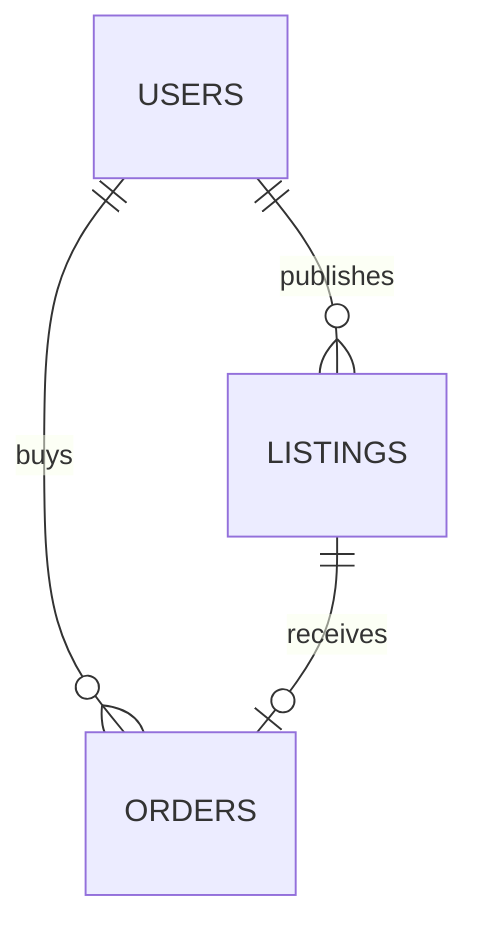

# PostBuy

PostBuy — командний MVP маркетплейсу. Користувач може продавати товари, купувати товари інших користувачів і переглядати свої оголошення та покупки.

## Схема даних MVP

Схема для перевірки використовує SQLite. Її початкова версія міститься у [db/schema.sql](db/schema.sql).



| Таблиця | Поля | Обмеження |
| --- | --- | --- |
| `users` | `id`, `name`, `email`, `password_hash`, `created_at` | Унікальний email. У базі зберігається хеш пароля. |
| `listings` | `id`, `seller_id`, `title`, `description`, `price_minor`, `status`, `created_at` | `seller_id` посилається на `users.id`. Назва й опис обов’язкові. Ціна — додатне ціле число в копійках. |
| `orders` | `id`, `listing_id`, `buyer_id`, `price_minor`, `status`, `created_at`, `confirmed_at` | `listing_id` посилається на `listings.id` і є унікальним. `buyer_id` посилається на `users.id`. Ціна фіксується на момент замовлення. |

### Поля форм

| Дія | Поля |
| --- | --- |
| Реєстрація | Ім’я, email, пароль |
| Вхід | Email, пароль |
| Редагування профілю | Ім’я |
| Публікація оголошення | Назва, опис, ціна у гривнях |
| Замовлення | ID оголошення. Покупця визначає сесія. |

### Статуси товару й замовлення

| Подія | Товар | Замовлення |
| --- | --- | --- |
| Продавець публікує оголошення | `available` — Доступно | |
| Покупець резервує товар | `reserved` — Зарезервовано | `pending` — Очікує підтвердження |
| Продавець підтверджує продаж | `sold` — Продано | `confirmed` — Підтверджено |

Каталог показує лише `available`. «Мої оголошення» фільтруються за `seller_id`, «Мої покупки» — за `buyer_id`, а отримані замовлення — за продавцем пов’язаного оголошення.

Під час резервування backend має в одній транзакції змінити статус лише доступного чужого оголошення й створити замовлення. Якщо оновлено нуль рядків, замовлення не створюється. Унікальний `orders.listing_id` додатково захищає від дублювання. Підтверджувати продаж може лише продавець цього оголошення. Backend має в одній транзакції встановити `confirmed` і `confirmed_at` для замовлення та `sold` для зарезервованого товару.

## Локальний запуск і перевірка бази

Потрібні Git Bash і Node.js 24 або новіший. Модуль `node:sqlite` вбудовано в Node.js, тому встановлення пакетів не потрібне.

```bash
git clone https://github.com/antonyyy3/PostBuy.git
cd PostBuy
node --version
```

Запусти з кореня репозиторію. Команда ініціалізує окрему базу у тимчасовій папці й перевіряє таблиці та зовнішні ключі.

```bash
node --input-type=commonjs - <<'NODE'
const assert = require('node:assert/strict');
const { mkdtempSync, readFileSync } = require('node:fs');
const { tmpdir } = require('node:os');
const { join } = require('node:path');
const { DatabaseSync } = require('node:sqlite');

const path = join(mkdtempSync(join(tmpdir(), 'postbuy-')), 'postbuy.sqlite');
const db = new DatabaseSync(path);

try {
  db.exec(readFileSync('db/schema.sql', 'utf8'));
  const tables = db.prepare(
    "SELECT name FROM sqlite_schema WHERE type = 'table' ORDER BY name"
  ).all().map(({ name }) => name);
  assert.deepEqual(tables, ['listings', 'orders', 'users']);
  assert.equal(db.prepare('PRAGMA foreign_keys').get().foreign_keys, 1);
  assert.deepEqual(db.prepare('PRAGMA foreign_key_check').all(), []);

  console.log('SQLite OK:', tables.join(', '));
  console.log('Database:', path);
} finally {
  db.close();
}
NODE
```

Очікуваний результат — `SQLite OK: listings, orders, users` і шлях до файлу бази. Кожен запуск створює окрему базу, щоб перевірка не змінювала попередні дані.

Ця версія репозиторію містить документацію і схему SQLite. Команди запуску backend і frontend слід додати після появи відповідних застосунків у репозиторії.
